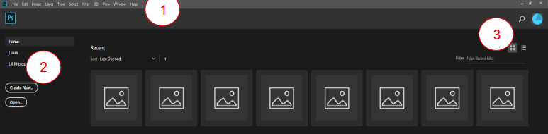
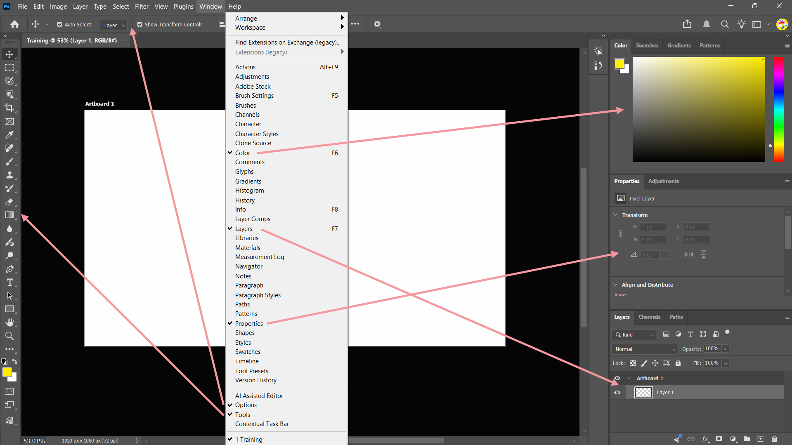



[Adobe Photoshop](https://my.uq.edu.au/information-and-services/information-technology/software-and-web-apps/uq-software-catalogue/adobe-software) is a raster graphics editor used for photo editing, image composition and digital art.

Find below the resources for our Photoshop sessions.

- [Manual](https://github.com/uqlibrary/technology-training-assets/raw/master/Photoshop/photoshop.pdf)
- [Files](https://github.com/uqlibrary/technology-training-assets/raw/master/Photoshop/PhotoshopImages.zip)

## Course objectives

By the end of this workshop, you will be able to:

- create a Photoshop project
- select and edit image content
- work with layers
- transform and position objects
- save an editable Photoshop file
- export an image for use online.

## Getting Started

### Exercise 1: Open Photoshop

1. Select the **Windows Start** button.
2. Search for and open **Adobe Photoshop**.

### Home Screen
1. Menu bar
2. Navigation Pane
    - **Home**: Recent Files
    - **Learn**: Tutorials for using Photoshop
3. View options – Thumbnails or List

{fig-alt="Photoshop home screen showing the menu bar, navigation pane and file display options."}

## Creating new documents

### Exercise 2: Create a document

1. In the navigation pane, select **New file**.
2. In the **New Document** window, select **Web**, then choose **Web Large**.

::: {.callout-note title="Why use Web Large?"}
**Web Large** is suitable for screen-based work. It provides enough resolution to edit the image and reduce its dimensions later when preparing it for a website.
:::

3. In the **Preset Details** pane, enter a filename such as `Training`.
4. Confirm that **Colour Mode** is set to **RGB Color**.
5. Keep the remaining default settings.
6. Select **Create**.

### File formats

Photoshop workflows commonly use three types of files:

- **Original source files:** Untouched photographs or images. JPEG is common on mobile devices. Digital cameras and some higher-end mobile devices can also capture RAW files. RAW extensions vary by manufacturer; `.dng` is Adobe's RAW format.
- **Working files:** Layered, editable files, usually saved as Photoshop documents (`.psd`).
- **Output files:** Finished images exported for use elsewhere, commonly as `.jpg` or `.png` files.

### Bit depth and colour modes

Digital images are made up of pixels. **Bit depth** describes how much colour information is available for each pixel.

- A bit depth of **1** produces a black-and-white image.
- A bit depth of **8** supports up to 256 tonal values per channel and is suitable for most web images.
- A bit depth of **16** supports up to 65,536 tonal values per channel. It produces larger files but preserves more image information during editing.

## The Main Screen

{fig-alt="Photoshop workspace showing the menu bar, tools, canvas and panel groups."}

1. The main workspace opens with several panels and panel groups.
2. Open a panel group's menu in its upper-right corner to view its options. For example, open the **Color** panel menu and select **Color Wheel**.
3. To remove a panel group that you do not need, open its menu and select **Close Tab Group**.
4. To reopen a panel, select it from the **Window** menu. For example, select **Window > Properties**.
5. Hover over a tool in the Tools panel to display its rich tooltip.

To turn off rich tooltips:

1. Select **Edit > Preferences > Tools**.
2. Clear **Show Rich Tooltips**.

When you select a tool, the **Options bar** at the top of the workspace changes to display settings for that tool. For example, selecting the **Quick Selection tool** displays the Quick Selection options.

To search Photoshop help, select the magnifying-glass icon in the upper-right corner or press <kbd>Ctrl</kbd> + <kbd>F</kbd>.

## Navigate an image

### Exercise 3: Zoom in and out

1. Select **File > Open**, then open `Butterfly.jpg` from the exercise files.
2. In the Layers panel, select the lock icon to unlock the background layer.
3. Select the **Zoom tool**, or press <kbd>Z</kbd>.
4. Position the pointer over the area you want to enlarge.
5. Select the image to zoom in.
6. Hold <kbd>Alt</kbd> and select the image to zoom out.
7. You can also select and hold, then drag horizontally to zoom in or out when scrubby zoom is enabled.

{fig-alt="Zoom tool showing zoom in cursor."}

### Exercise 4: Pan an image

1. Select the **Hand tool**, or press <kbd>H</kbd>.
2. Select and drag to move the image within the document window.

::: {.callout-tip}
Hold the <kbd>Spacebar</kbd> while using another tool to temporarily activate the Hand tool.
:::

## Make selections

Selections identify the area of an image that you want to edit.

### Exercise 5: Practise selection techniques

#### Rectangular Marquee tool

1. In the Tools panel, select the **Rectangular Marquee tool**, or press <kbd>M</kbd>.
2. Select and drag around the butterfly and pot.
3. Press <kbd>Ctrl</kbd> + <kbd>D</kbd>, or select **Select > Deselect**, to remove the selection.
4. Select and hold the Marquee tool to view the other marquee tools.

#### Lasso tool

1. Select the **Lasso tool**, or press <kbd>L</kbd>.
2. Select and drag around the outside edge of the butterfly.
3. Optionally, press <kbd>Caps Lock</kbd> to change the pointer for more precise selection.

#### Magnetic Lasso tool

1. Select and hold the **Lasso tool**, then choose the **Magnetic Lasso tool**. You can also press <kbd>Shift</kbd> + <kbd>L</kbd> to cycle through the Lasso tools.
2. Select once near the edge of the butterfly to begin.
3. Move the pointer around the butterfly. Photoshop places anchor points as the selection follows the edge.
4. Select the starting point, or double-click, to close the selection.

#### Quick Selection tool

1. Select the **Quick Selection tool**, or press <kbd>W</kbd>.
2. Select and drag inside the butterfly so Photoshop can identify its edges.
3. To add to the selection, continue painting inside the object.
4. To remove part of the selection, hold <kbd>Alt</kbd> while painting over the unwanted area.

## Transform selected content

### Exercise 6: Resize and rotate a selection

1. Select the butterfly using one of the selection methods from the previous exercise.
2. Select **Edit > Free Transform**, or press <kbd>Ctrl</kbd> + <kbd>T</kbd>.
3. Drag a corner handle outward to enlarge the butterfly.
4. Drag a corner handle inward to reduce its size.
5. Move the pointer outside a corner handle, then drag to rotate the butterfly.
6. Press <kbd>Enter</kbd>, or select the tick in the Options bar, to apply the transformation.

::: {.callout-warning}
Transforming pixels directly can leave an empty area in the original image. Keep an untouched source file and work non-destructively where possible.
:::