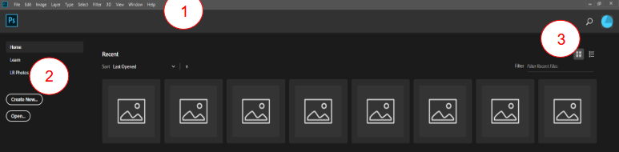
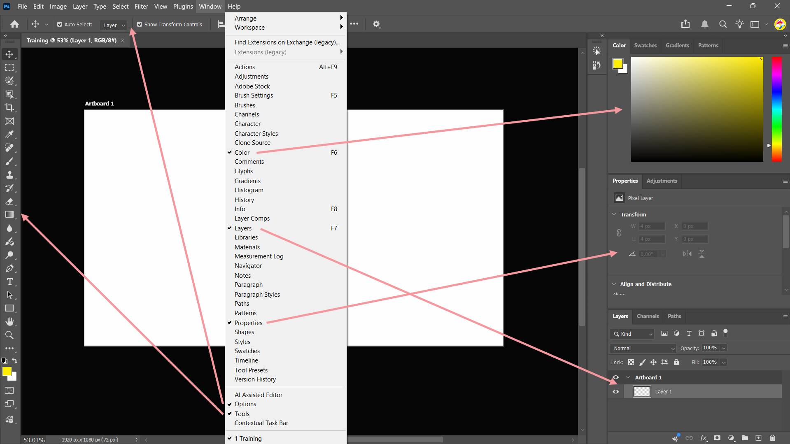



[Photoshop](https://my.uq.edu.au/information-and-services/information-technology/software-and-web-apps/uq-software-catalogue/adobe-software) is a raster graphics editor used for photo-editing and digital art.

Find below the resources for our Photoshop sessions.

* [Manual](https://github.com/uqlibrary/technology-training-assets/raw/master/Photoshop/photoshop.pdf)
* [Files](https://github.com/uqlibrary/technology-training-assets/raw/master/Photoshop/PhotoshopImages.zip)

## Course objectives
* Create a Photoshop project
* Working with Layers – Selecting and Editing
* Export Results

## Getting Started
1. **Click** the Windows Icon/Start button in the bottom left corner
2. **Click** Adobe Photoshop

### Home Screen
1. Menu bar
2. Navigation Pane
    - Home: Recent Files
    - Learn: Tutorials for using Photoshop
3. View options – Thumbnails or List

## Creating new documents

1. In the Navigator pane click **New File**
2. Click **Web > Web Large** in the New Document window

:::{.callout-note}
Choosing Web Large is suitable for screen work and allows you to rescale to a smaller size if necessary. This is a good choice if you are creating an image for posting to websites.
:::

3. **Change** the Filename in the **Preset Details** pane e.g. Training
4. Check the **colour mode** is **RGB**
5. **Accept** all other default settings
6. Click **Create** at the bottom of the New Document window screen

### Some information on
#### File formats
There are three types of files in Photoshop:

* **Original source material** – Untouched files. `.jpg` is the most common, as it is the default format on many mobile devices. RAW files are captured by digital cameras and some higher-end mobile devices. RAW file extensions vary depending on the manufacturer. `.dng` is Adobe's RAW format.
* **Working files** – Layered and retouched files, usually saved as `.psd`
* **Output files** – Usually saved as `.jpg` or `.png`

#### Bit Depth and Colour modes
Images are made up of individual pixels. A 6cm x 7cm image that is 1mb in size can have roughly 3 or 4 megapixels (3 or 4 million pixels).

* **Bit Depth** – the amount of information for each pixel in an image
* A bit depth of 1 gives a black and white image
* A bit depth of 8 allows each pixel to have up to 256 colours – perfect for web based images
* A bit depth of 16 allows each pixel to have up to 65536 colours – considered high colour – large file sizes but maintains higher quality during post production

## The Main Screen

1. The Main Screen opens with several panes or Tab Groups
2. Click Control button (Top Right Corner) to see Tab Group options e.g Color Tab Group > Control button > Color Wheel
3. Click Close Tab Group if the Panel is not required e.g Properties Tab Group > Control button > Close Tab Group
4. Click Window menu
5. Select Properties (This will reopen the Properties Tab Group Panel)
6. Hover over a tool on the Tools bar to see a Rich Tooltip which is short animated graphic of the tool

If you do not wish to see Rich Tooltips…

7. Select Edit > Preferences > Tools
8. Clear Show Rich Tooltips
9. Selecting a tool activates the Options bar at the top of the screen
10. Select the Quick Selection tool (The options bar at the top changes to Quick Selection Options)
11. Use Search to locate help on all things photoshop
12. Click Magnifying glass (top right) or Ctrl + F